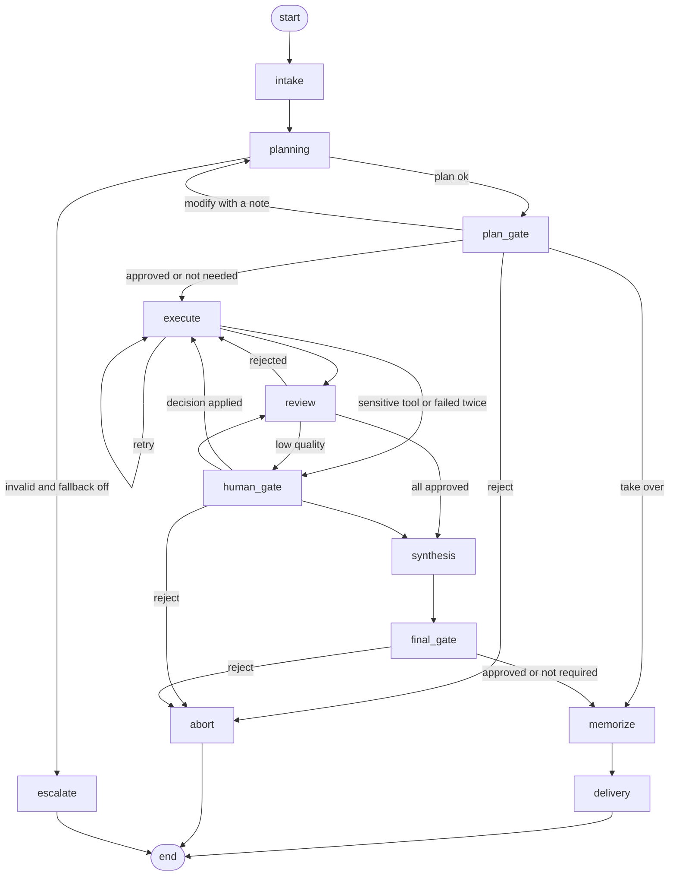
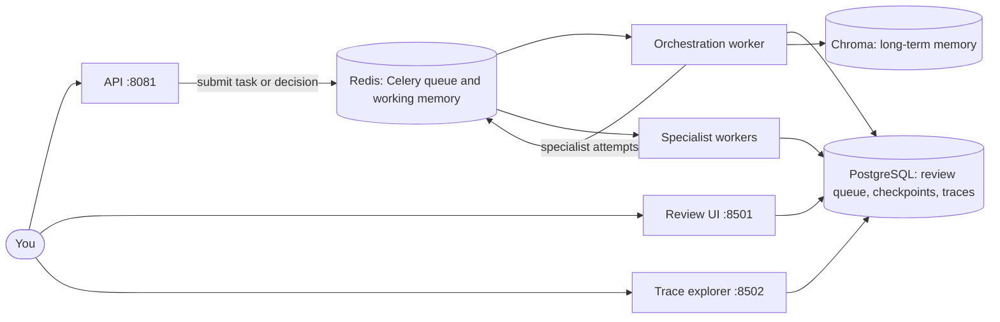

# Agent Orchestration System

A multi-agent orchestration platform built with **LangGraph**. A supervisor agent decomposes a complex task into a validated plan, specialist agents execute it with permission-scoped tools, a reviewer checks every result against the real tool output, and a human is asked whenever confidence is low or an action is sensitive. Every decision is traced, costed and replayable, and the whole system starts with one `docker compose` command.


It runs **fully locally** with [Ollama](https://ollama.com): no API key and no cost. Cloud models are optional.


## Features

**Agents and tools**
- Supervisor, four specialists (research, data analysis, writing, code execution) and a reviewer, each a node in a LangGraph state machine.
- Structured task decomposition with dependencies. Plans are validated (unknown dependencies, duplicates and cycles are rejected). A malformed plan from a weak model is retried, then replaced by a single-subtask fallback that a human approves.
- Tool registry with per-agent permissions, rate limits, input/output schemas and a JSON call log.
- The reviewer sees the **tool evidence**, so it catches fabricated results. Rejections go back to the specialist with feedback, and retries are bounded.

**Memory**
- Working memory per task (Redis, with an in-process fallback), cleared when the task ends.
- Long-term semantic memory (ChromaDB): what was asked, the plan, what worked, what failed, facts, preferences and human decisions. Retrieved memories are injected into planning as hints.
- Importance scoring, consolidation, decay and expiry, a dashboard, and per-user delete endpoints.

**Human in the loop**
- Escalation triggers mapped to four levels: **Notify**, **Approve action**, **Approve plan**, **Take over**, plus an optional approval of the final deliverable.
- Durable pause and resume: the graph is checkpointed, the process can exit, and a decision hours later continues the same run.
- Sensitive tools (deleting files, sending messages, non-GET API calls) cannot run without approval. This is enforced in the tool layer, not in a prompt.
- Streamlit review UI with the plan, proposed action, relevant memories and a chat panel to question the agent before deciding.

**Observability**
- OpenTelemetry spans for every node, agent decision, LLM call (full prompt and response), tool call and human event.
- Trace explorer UI, a cost and performance dashboard, and a **replay engine**: re-run a past task from its recorded decisions, change any input or output, and compare the result with the original.

**Deployment**
- `docker compose` with the API, Celery workers (orchestration and specialist pools), PostgreSQL, Redis, a Chroma server and both UIs, plus a demo script that runs a showcase scenario and verifies it.
- A test suite of 91 tests that needs no models, network or API keys.

## Architecture





| Escalation trigger | Level | Pauses? |
|---|---|---|
| User requested review, or plan confidence below threshold | Approve plan | Yes |
| Sensitive tool requested | Approve action | Yes |
| Quality score below threshold | Approve action | Yes |
| Same subtask failed twice | Take over | Yes |
| Final deliverable approval requested | Approve action | Yes |
| Borderline quality | Notify | No |

## The demo scenario

Task: *"Research the pros and cons of vector databases for a small startup team, analyze the benchmark data, and write a recommendation."*

1. The supervisor splits it into four subtasks. The two research steps run **in parallel** on separate Celery workers.
2. The analysis step runs real code (`run_python`) on the benchmark table.
3. The reviewer **rejects the first draft** (no citations) and sends feedback. The second draft passes.
4. A **human approves the final deliverable** before it is delivered.
5. A second, similar task retrieves the lesson from **memory**, so its plan asks for citations up front and passes on the first try.

The demo runs with **scripted agents and fictional data** so the showcase happens every time. The graph, tools, memory, review queue, tracing and Celery workers are all real. With `DEMO_MODE=0` the same scenario runs on your real models, and the outcomes then vary.

| Review UI | Trace explorer, run A (reviewer catches a problem) |
|---|---|
|  |  |

| Trace explorer, run B (memory used, no rejection) | Replay: what if the reviewer had approved? |
|---|---|
|  |  |

## Quick start

### Option A: everything in Docker (recommended)

Requires Docker Desktop. No models and no API keys are needed for the demo.

```powershell
git clone https://github.com/Shimaaelkanj/agent-orchestration-system.git
cd agent-orchestration-system
Copy-Item .env.example .env           # Linux/macOS: cp .env.example .env

docker compose build init
docker compose up -d
docker compose ps
Invoke-RestMethod http://localhost:8081/health      # expect: database postgres, redis ok

docker compose --profile demo run --rm demo         # runs the showcase and prints [OK] checks
```

| Service | URL |
|---|---|
| API (OpenAPI docs) | http://localhost:8081/docs |
| Review UI | http://localhost:8501 |
| Trace explorer | http://localhost:8502 |

Run `docker compose --profile demo run --rm demo python scripts/demo.py --manual` to approve the final deliverable yourself in the review UI. `docker compose down` stops everything and keeps the data, and `docker compose down -v` also deletes it.

The API's host port is `API_PORT` (default 8081). Inside Docker it is always 8080.

### Option B: local, with Ollama

Requires Python 3.10+ and [Ollama](https://ollama.com). Redis is optional.

```powershell
python -m venv .venv
.\.venv\Scripts\Activate.ps1          # Linux/macOS: source .venv/bin/activate
pip install -r requirements.txt

ollama pull llama3.2
ollama pull nomic-embed-text

Copy-Item .env.example .env
python -m orchestrator.main "Write a Python function that checks if a number is prime, test it on 10 numbers, and summarize the result"
```

## Usage

| Goal | Command |
|---|---|
| Run a task | `python -m orchestrator.main "your task"` |
| Ask for human review of the plan | `python -m orchestrator.main --review "your task"` |
| Ask for approval of the final deliverable | `python -m orchestrator.main --approve-final "your task"` |
| Review UI (approve, modify, reject, take over, chat) | `python -m streamlit run orchestrator/hitl/ui.py` |
| Review from the terminal | `python -m orchestrator.hitl.cli list`, then `show <id>` and `decide <id> approve --resume` |
| Trace explorer, costs and replay | `python -m streamlit run orchestrator/obs/ui.py --server.port 8502` |
| Text view of the latest trace | `python -m orchestrator.obs.tree` |
| Replay a task | `python -m orchestrator.obs.replay run <task_id>` |
| Memory dashboard and delete endpoints | `uvicorn orchestrator.memory.api:app --port 8000`, then open `/dashboard/default` |
| Graph diagram | `python -m orchestrator.main --diagram` |

HTTP API (Docker): `POST /tasks`, `GET /tasks`, `GET /tasks/{id}`, `GET /reviews`, `POST /reviews/{id}/decision`, `GET /health`.

### Using cloud models instead

Remove `OPENAI_BASE_URL` from `.env`, set real keys and models, for example `SUPERVISOR_PROVIDER=openai` with `SUPERVISOR_MODEL=gpt-4o-mini`, or `*_PROVIDER=anthropic` with `ANTHROPIC_API_KEY`. Cloud usage is billed by the provider. Add model prices to `data/pricing.json`, because the built-in table only has example values.

## Project structure

```
orchestrator/
  graph.py            LangGraph state machine, escalation gates, replay-safe side effects
  schemas.py          Plan, subtask, report and verdict models; plan validation
  llm.py              Model factory, structured output with fallbacks, tracing callbacks
  config.py           All settings, read from the environment
  db.py               SQLite / PostgreSQL abstraction
  agents/             supervisor, specialists, reviewer, fallback plan
  tools/              registry (permissions, rate limits, sensitive-tool gate) and built-in tools
  memory/             working memory, long-term memory, retrieval, management, API, CLI
  hitl/               policy, approval queue, review UI, chat panel, checkpoints, resume
  obs/                tracing, span store, decision recording, replay, metrics, trace explorer
  worker/             Celery app, tasks and the remote specialist client
  api/                FastAPI service
  demo/               scripted showcase agents and the fictional search corpus
scripts/              demo runner and diagnostic helpers
tests/                offline tests (unit, graph, memory, human-in-the-loop, observability, end-to-end, UIs)
Dockerfile, docker-compose.yml
```

## Design decisions

- **Safety lives in code.** Sensitive tools raise an approval request before anything runs, and the system, not the model, executes the approved action.
- **Never trust model output.** Plans, tool inputs and outputs are validated, and the reviewer judges against tool evidence.
- **Failure is a normal path.** Bounded retries, feedback loops, a fallback plan and escalation are designed in.
- **Decisions are recorded as inputs and outputs**, which makes free, deterministic replay possible.
- **Memory is advice, not truth.** Retrieved memories are injected as hints that the current request always overrides.
- **Side effects have a single gate.** Memory writes, review creation and tool execution are disabled during replay.

## Testing

```powershell
python -m pyflakes orchestrator tests
python -m pytest -q
```

The suite uses fake agents, scripted agents and a deterministic embedder, so it needs no models, network or API keys. It covers task decomposition, tool use, the reviewer catching bad output, memory improving repeated tasks, every escalation path, failure recovery, restart-safe pause and resume, tracing, cost maths, replay and the Streamlit UIs. Optional PostgreSQL contract tests run when `TEST_DATABASE_URL` is set.


## Known limitations

- The demo uses **scripted agents and fictional data**. Real models give less predictable results: small local models (about 3B parameters) struggle with structured planning and judging, which is why retries, a fallback plan and human gates exist. A 7B model such as `qwen2.5:7b` works noticeably better.
- The UIs and API have **no authentication** and are bound to `127.0.0.1`. The compose file ships demo-only database passwords.
- Code execution is lightly isolated (temporary directory, minimal environment, timeout), not a real sandbox.
- `send_email` is a simulation that writes to `workspace/outbox`.
- Per-tool rate limits are per process.
- Cost figures depend on the price table, which only contains example values.
- Developed and tested on Windows (PowerShell) with Python 3.10 locally and 3.11 in Docker.

## Ideas for next steps

- An evaluation set of benchmark tasks with expected outcomes and a scoring script.
- Real authentication and a container-based sandbox for code execution.
- Shared (Redis-based) rate limits and retention jobs for old traces and memories.

| LLM prompt and response | Cost and performance |
|---|---|
|  |  |

